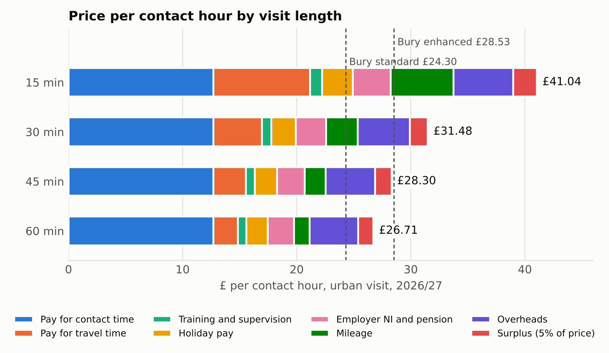
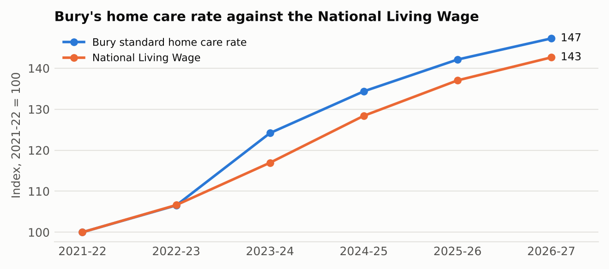
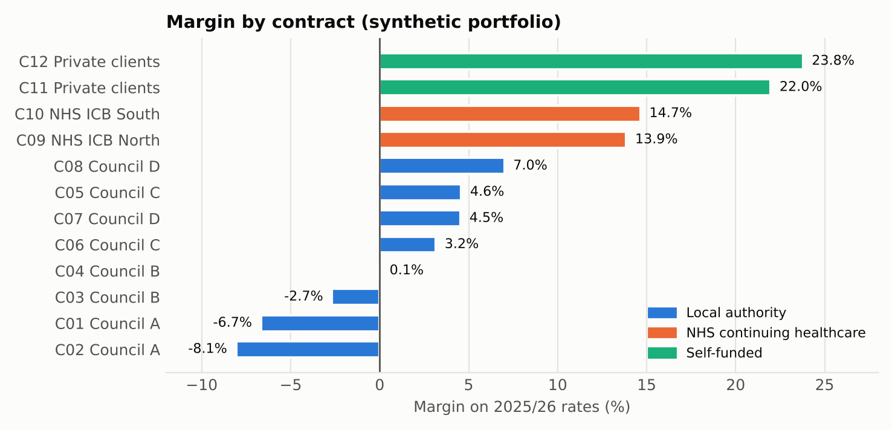
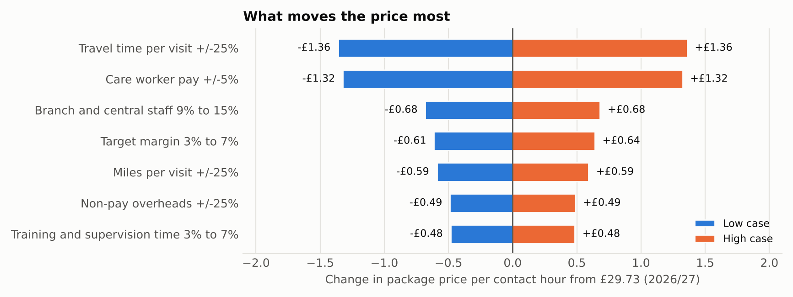

# Care Contract Pricing: what a home care hour costs, and what to charge

A pricing and contract model for a provider of home care and care homes. It builds the price of a home care visit up from the National Living Wage, tests a council's published fee rates against it, works out the fee uplift each contract needed for 2026/27, runs a bid or no-bid test on a tender, finds break-even occupancy for care homes and looks for savings in supplier spend.

The same model exists twice: in Python and in a formula-driven Excel workbook ([Care_Contract_Pricing_Model.xlsx](Care_Contract_Pricing_Model.xlsx), 969 formulas, no pasted results). The tests check that the two agree.

A one-page [commercial brief](Commercial_Brief.pdf) sets out the findings and recommendations for a commercial director.

**Data.** Pay rates, statutory on-costs, mileage rates and Bury Council's fee rates are published figures (sources below). The contracts, care homes, tender and supplier ledger are synthetic and describe no real provider.

## Findings

**1. A typical urban home care hour costs £28.25 to deliver in 2026/27 and needs £29.73 to earn a 5% margin.** Care worker pay, holiday and employer on-costs make up 76% of that cost, in line with the Homecare Association's figure of at least 75%.

**2. Short and rural visits cost far more per hour.** A 15-minute visit needs £41.04 per contact hour against £26.71 for an hour-long visit, because the same travel time and mileage are spread over fewer paid minutes. A rural 30-minute visit needs £40.28 per contact hour against £31.48 in town (prices at a 5% margin).



**3. In this model, Bury's 2026/27 standard rate covers the direct cost of care but little else.** At £24.30 an hour it leaves 50p after the £23.80 direct cost (care worker pay, on-costs and mileage), which covers 11% of the £4.44 of overheads in the model. Bury's enhanced rate (£28.53) clears full cost with a margin of about 1%. Since 2021/22 Bury's standard rate has risen 47%, against 43% for the National Living Wage.



**4. Council work is three quarters of the synthetic portfolio's revenue and loses money overall.** Council contracts run at a margin of minus 0.5%; NHS continuing healthcare (14.2%) and self-funded clients (22.6%) carry the portfolio margin of 4.2%. Three of twelve contracts lose money and seven sit below the 5% target.



**5. Bury's 3.6% uplift would not have held margins in 2026/27.** The National Living Wage rise (£12.21 to £12.71) and CPI of 3.2% on non-pay costs raised the cost of the portfolio by 3.9%. HMRC then raised its approved mileage rate from 45p to 55p a mile, backdated to April 2026 but announced in May, after Bury had set its fees in March; passing that on adds another 1.8 points. Against a 5.6% rise in costs, a 3.6% uplift on every contract cuts the portfolio margin from 4.2% to 2.3%, takes council work from minus 0.5% to minus 2.5% and leaves about £249,000 a year unfunded on £12.2m of revenue. Bringing the weakest council contracts up to a 5% margin would need uplifts of 14% to 21%.

**6. The illustrative tender is a "bid with conditions".** With 40% of hours in rural areas the blended cost is £30.98 an hour, so the £32.20 ceiling rate gives a 3.8% margin: below the 5% target but above the 2% floor. The tender reaches the target only if rural hours stay at or below 34%, and it needs 30 new care workers against 24 we could recruit in time. The conditions are a rural travel supplement or a cap on rural hours, and a phased start.

**7. One care home is below break-even.** Home 4 (nursing dementia) loses about £75,600 a year at 82% occupancy; it breaks even at 86.6%, about two more residents. Home 2 is close behind, with a 2.9% margin.

**8. Travel time moves the price as much as pay does.** A 25% change in travel time per visit moves the package price by £1.36 an hour, slightly more than a 5% change in care worker pay (£1.32), so rota planning is worth as much attention as the pay rate.



**9. Supplier savings of about £68,900 on £1.36m of spend (5.1%).** £12,300 comes from buying gloves, aprons and continence pads at the lowest price already being paid, and £56,600 from filling 30% of agency hours (average £26.22 an hour) with employed care workers (£16.14 an hour including holiday and on-costs).

## The workbook

| Sheet | What it does |
|---|---|
| Inputs | Pay, statutory on-costs, mileage, travel time, overheads, margin and visit mix. Blue cells are inputs; change one and every sheet recalculates. |
| Rate build-up | Cost and price of 15, 30, 45 and 60-minute visits, urban and rural, for 2025/26 and 2026/27, line by line. |
| Contracts | Margin on each contract, the uplift each needs to hold its margin, the margin at the offered uplift and the income gap. |
| Care homes | Occupancy, average fee, margin, break-even occupancy and residents short of break-even. |
| Bid | Cost, margin at the ceiling, walk-away rate, highest workable rural share, checks and the decision. |
| Sensitivity | Each driver moved low and high, with a tornado table and chart. |
| Suppliers | A year's purchase ledger, spend by category, like-for-like price savings and agency savings. |
| Bury rates | Six years of Bury's published rates against the National Living Wage, and the 2026/27 rate against the model. |

For 2027/28, enter the new National Living Wage, CPI and the uplift offered on the Inputs sheet.

## How to run

```
pip install -r requirements.txt
python build.py        # writes the synthetic data, results.json, the figures and the workbook
python -m pytest -q    # 11 checks, including the workbook against the Python model
```

openpyxl saves formulas without their values, so a rebuilt workbook shows numbers once Excel (or LibreOffice) has recalculated and saved it; the Excel check is skipped until then. The workbook in this repository is already recalculated.

| File | Contents |
|---|---|
| pricing.py | Cost and price of a visit, employer on-costs, package rates, pricing schedule |
| contracts.py | Contract profitability and care home break-even |
| uplift.py | Fee uplift needed against uplift offered |
| bid.py | Bid or no-bid test |
| sensitivity.py | Tornado table |
| suppliers.py | Spend by category, price variance and agency savings |
| make_data.py | Writes the synthetic inputs |
| excel_model.py | Builds the formula-driven workbook |
| charts.py, build.py | Figures and the full run |
| test_model.py | Checks on the arithmetic, the decision rules and Excel against Python |
| Commercial_Brief.pdf, commercial_brief.tex | One-page brief and its LaTeX source |
| bury_fee_rates.csv | Bury Council standard and enhanced rates, 2021/22 to 2026/27, with the National Living Wage |

## Method

**Visit cost.** Pay covers contact time, travel time and an allowance for training, supervision and meetings. Holiday pay is accrued at 12.07%. Employer National Insurance (15% above £5,000 a year) and pension (3% of qualifying earnings between £6,240 and £50,270) are worked out on a care worker's annual pay and applied as a rate. Mileage is paid per mile. Branch and central staff are a share of care worker cost, and non-pay overheads are a cost per contact hour. Price is cost divided by one minus the target margin.

**Packages and contracts.** A package or contract rate per contact hour is the hours-weighted average of the visit lengths it contains, split between urban and rural visits.

**Fee uplift.** Contract rates are 2025/26 rates. The uplift needed to hold a contract's margin equals the growth in its cost per hour from 2025/26 to 2026/27. The margin at the offered uplift compares 2026/27 cost with the uplifted rate.

**Bid test.** Bid when the margin at the ceiling meets the target and recruitment covers the new staff needed; bid with conditions when the margin is at least the 2% floor; otherwise do not bid.

**Care homes.** Break-even occupancy is weekly fixed cost divided by the gap between the average fee and the variable cost per resident, over the number of beds.

| Assumption | Value | Basis |
|---|---|---|
| Care worker pay | £12.21 (2025/26), £12.71 (2026/27) | National Living Wage |
| Paid hours a week | 30 | Assumption, for on-costs |
| Holiday accrual | 12.07% | 5.6 weeks' statutory holiday |
| Training, supervision and meetings | 5% of visit and travel time | Assumption |
| Travel time per visit | 10 minutes urban, 18 rural | Assumption |
| Miles per visit | 2.5 urban, 5.5 rural | Assumption |
| Mileage rate | 45p (2025/26), 55p (2026/27) | HMRC approved mileage rate |
| Branch and central staff | 12% of care worker cost | Assumption |
| Non-pay overheads | £1.80 per contact hour in 2025/26, plus CPI | Assumption |
| Target margin | 5% of price | Assumption; average homecare EBITDA margin was 6.3% in October 2025 |
| Visit mix | 5% / 40% / 25% / 30% of hours in 15 / 30 / 45 / 60-minute visits | Assumption |

## Limits

* Travel time, overheads and the visit mix are assumptions. A provider's rota, payroll and ledger data would replace them, and the conclusions about Bury's rates depend on them.
* Statutory sick pay, sleep-ins, waking nights, weekend and bank holiday enhancements, the Apprenticeship Levy and the Employment Allowance are not modelled.
* Results for the synthetic portfolio, homes, tender and suppliers show the method, not real market margins.

## Sources

* GOV.UK, [National Minimum Wage and National Living Wage rates](https://www.gov.uk/national-minimum-wage-rates) (current and previous rates).
* GOV.UK, [Rates and thresholds for employers 2026 to 2027](https://www.gov.uk/guidance/rates-and-thresholds-for-employers-2026-to-2027) (employer National Insurance; approved mileage rate of 55p).
* DWP, [Review of the automatic enrolment earnings trigger and qualifying earnings band for 2026/27](https://www.gov.uk/government/publications/review-of-the-automatic-enrolment-earnings-trigger-and-qualifying-earnings-band-for-202627/review-of-the-automatic-enrolment-earnings-trigger-and-qualifying-earnings-band-for-202627).
* GOV.UK, [Holiday entitlement](https://www.gov.uk/holiday-entitlement-rights).
* Bury Council, [Adult social care fee rates](https://www.bury.gov.uk/social-care-and-support/adult-social-care/paying-for-care/adult-social-care-fee-rates), and [Adult Social Care Provider Fees, Cabinet report, 11 March 2026](https://councildecisions.bury.gov.uk/documents/s48534/Adult%20Social%20Care%20Provider%20Fees.pdf) (3.60% uplift on the standard home care rate; CPI 3.2% for November 2025).
* Homecare Association, [release of 22 December 2025](https://www.homecareassociation.org.uk/resource/homecare-association-minimum-price-exposes-england-s-homecare-funding-gap-as-new-employment-law-takes-effect.html) (staffing at least 75% of cost; average EBITDA margin 6.3% in October 2025).
* Rayner Essex, [Approved mileage rates increase from April 2026](https://rayneressex.com/news/approved-mileage-rates-increase-from-april-2026/) (announcement date of the 55p rate).

## Licence

MIT. Built by Nihal Naresh Kumar.
